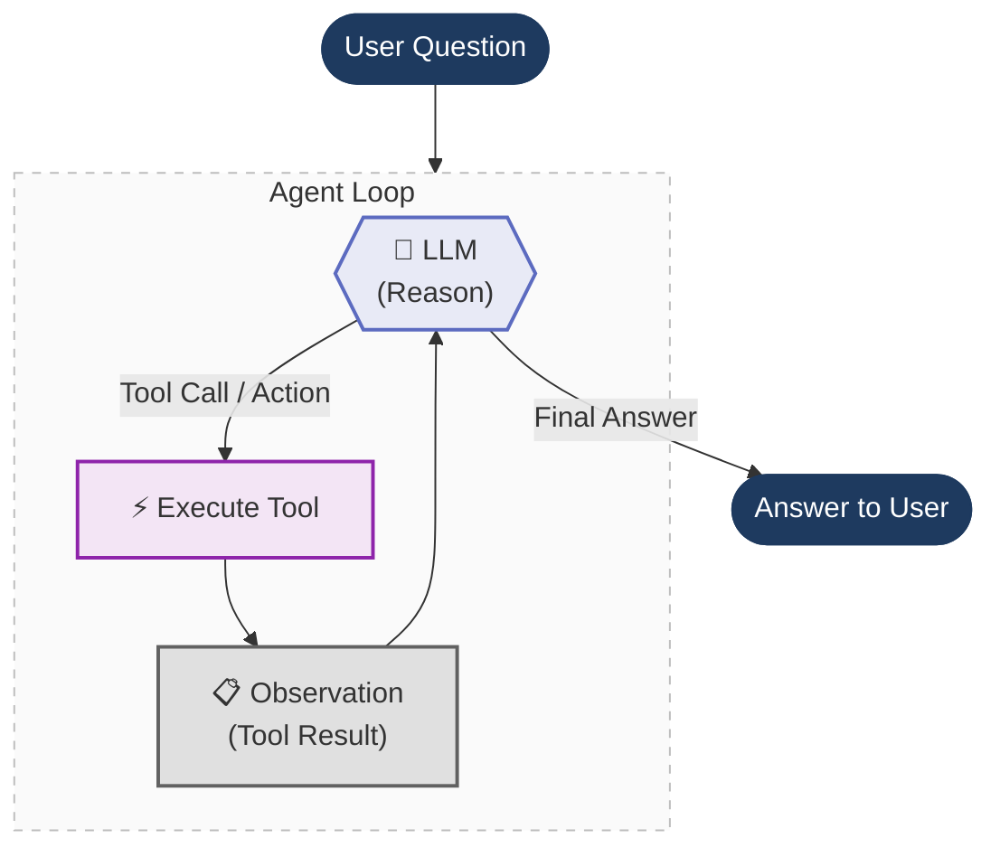

# Agents Under the Hood

**Peeling back the layers of a tool-using agent, from LangChain abstractions to raw prompt engineering.**

This project builds the same shopping assistant three ways. Each example uses a local Ollama model and the same Python tools, while changing how the model receives tool descriptions and how the application handles its response.

## The Big Idea

All three examples follow a common agent loop: the model reasons about the question, requests a tool, receives the tool result, and continues until it returns a final answer. The implementations expose different parts of that loop:

1. **LangChain tool calling** uses `@tool`, `bind_tools()`, typed messages, and LangChain's tool invocation.
2. **Raw function calling** sends manually written JSON schemas to Ollama and routes structured tool calls to Python functions.
3. **Raw ReAct prompting** describes tools in a text prompt, then parses `Action` and `Action Input` from the model's response.

The third example shows how to build the loop without native structured tool calls. It uses the ReAct format from the [Yao et al. paper](https://arxiv.org/abs/2210.03629): `Thought`, `Action`, `Action Input`, and `Observation`.

Each file is a standalone script and can be run independently.

The boxes below illustrate the examples as successive abstraction layers:

```text
┌──────────────────────────────────────────────┐
│  File 1: LangChain                           │  ← @tool, bind_tools(), ToolMessage
│  ┌────────────────────────────────────────┐  │
│  │  File 2: Raw Function Calling          │  │  ← Hand-written JSON schemas, ollama.chat()
│  │  ┌─────────────────────────────────┐   │  │
│  │  │  File 3: Raw ReAct Prompt       │   │  │  ← Prompt template, regex, scratchpad
│  │  └─────────────────────────────────┘   │  │
│  └────────────────────────────────────────┘  │
└──────────────────────────────────────────────┘
```

This is an abstraction-level illustration: the scripts do not depend on or call one another.

## Requirements and Setup

- Python `>=3.11,<4.0`
- [uv](https://docs.astral.sh/uv/getting-started/installation/) for Python environment and dependency management
- [Ollama](https://ollama.com/download) installed and running locally
- Network access to download the model tags on first use

From the repository root, install the dependencies into a local virtual environment:

```bash
uv sync --no-install-project
```

The examples are standalone scripts, so `--no-install-project` installs their dependencies without building the repository as a package.

The LangChain and raw function-calling scripts default to `qwen3.5:9b`. The raw ReAct script defaults to `qwen3:1.7b`. Download the model tags:

```bash
ollama pull qwen3.5:9b
ollama pull qwen3:1.7b
```

Ollama's desktop application generally starts the local service. If it is not running, start it in a separate terminal before downloading or using a model:

```bash
ollama serve
```

Use `ollama list` to see the models available locally. See the [Ollama quickstart](https://docs.ollama.com/quickstart) and [CLI reference](https://docs.ollama.com/cli) for installation and command details.

## Run the Agents

Run one script at a time from the repository root:

```bash
uv run --no-sync python langchain-react-agent.py
```

```bash
uv run --no-sync python raw-function-calling.py
```

```bash
uv run --no-sync python raw-react-agent.py
```

Each script starts with the sample question: “What is the price of a laptop after applying a gold discount?” Edit the `run_agent(...)` call in the script's `Main Execution` section to use a different question.

## The Agent Loop

The model and tool-selection steps vary by script. Each loop sends the current context to Ollama, handles a final answer or tool request, adds tool results to the context, and continues.



Here is how each script implements the same steps:

| Step | LangChain tool calling | Raw function calling | Raw ReAct prompt |
| --- | --- | --- | --- |
| Model response | Structured `tool_calls` | Structured `tool_calls` | `Thought`, `Action`, and `Action Input` as plain text |
| Parse | Read `ai_message.tool_calls[0]` | Read `tool_call.function.name` and `.arguments` | Use regular expressions to find `Action:` and `Action Input:` |
| Execute | Call `tool.invoke(tool_args)` | Call `tool(**tool_args)` | Call `tools[name](*args)` |
| Observe | Append a `ToolMessage` | Append a `{"role": "tool"}` message dictionary | Append the model output and observation to a scratchpad string |
| Finish | Return when there are no tool calls | Return when there are no tool calls | Return when `Final Answer:` appears in the text |

## Implementations

### 1. LangChain Tool Calling

**File:** [`langchain-react-agent.py`](langchain-react-agent.py)

This is the highest-level implementation. The two Python functions use LangChain's `@tool` decorator. LangChain derives tool schemas from their signatures and docstrings. The script initializes the Ollama model with `init_chat_model()`, binds the tools with `bind_tools()`, and runs the agent loop.

The loop reads the first tool call from `ai_message.tool_calls`, invokes it with `tool.invoke(tool_args)`, then adds the result to the message history as a `ToolMessage` with the matching tool-call ID.

This version demonstrates LangChain's typed message objects, tool binding, and invocation. It does not include a manually written JSON schema for each function.

### 2. Raw Function Calling

**File:** [`raw-function-calling.py`](raw-function-calling.py)

This implementation uses the Ollama Python SDK directly for model calls and does not use LangChain's tool APIs. It builds a dictionary mapping tool names to Python functions and defines the JSON schema for each tool by hand.

The agent sends those schemas to `ollama.chat()`, reads the returned tool name and arguments from `response.message.tool_calls`, calls the Python function, then adds the result as a raw `{"role": "tool", "content": ...}` message. This makes the schema and message routing that a framework can manage visible in the code.

### 3. Raw ReAct Prompt

**File:** [`raw-react-agent.py`](raw-react-agent.py)

This implementation calls Ollama without passing structured tool schemas. Instead, it builds tool descriptions from the Python function signatures and docstrings, then includes them in a ReAct prompt. The model is asked to return `Thought`, `Action`, and `Action Input` text.

The script stops generation at `\nObservation` so it can insert the real tool result. It parses the action fields with regular expressions, runs the matching Python function, and appends the model output and observation to a scratchpad for the next iteration. The parser expects comma-separated arguments, so this approach depends on the model following the requested format.

## The Same Agent, Three Ways

All scripts use the same sample question and tools:

> What is the price of a laptop after applying a gold discount?

- `get_product_price(product)` looks up a price in a simulated catalog: laptop `1299.99`, headphones `149.95`, and keyboard `89.50`.
- `apply_discount(price, discount_tier)` applies bronze (5%), silver (12%), or gold (23%) and rounds the result to two decimal places.

For the sample question, the expected tool sequence is:

1. `get_product_price("laptop")` returns `1299.99`.
2. `apply_discount(1299.99, "gold")` returns `1000.99`.
3. The agent returns the final price.

The system and prompt rules require the model to look up the price and use the discount tool. The agent should not guess the price or calculate the discount in its final response.

## Configuration

### Models and Questions

Each script sets the model name in a `MODEL` constant:

| Script | Default model |
| --- | --- |
| `langchain-react-agent.py` | `qwen3.5:9b` |
| `raw-function-calling.py` | `qwen3.5:9b` |
| `raw-react-agent.py` | `qwen3:1.7b` |

To change models, update the relevant constant and download the corresponding Ollama tag with `ollama pull <model-tag>`. The sample question is passed to `run_agent(...)` in each script's `Main Execution` section.

### Console Output

`utils.py` provides `format_box()` for a bordered message and `format_box_sections()` for one box with dashed dividers between sections. It also includes a `format_time()` helper.

## Optional LangSmith Tracing

The raw agent examples decorate their agent loops, model helpers, and tools with LangSmith's `@traceable`. The LangChain example decorates its agent loop and uses LangChain-managed tracing for model and tool calls. Running Ollama locally does not require a LangSmith account.

To send traces to LangSmith, create a `.env` file in the repository root:

```dotenv
LANGSMITH_TRACING=true
LANGSMITH_API_KEY=your-langsmith-api-key
LANGSMITH_PROJECT=langchain-agent-research
```

Each script calls `load_dotenv()` to load this file. `.env` is ignored by Git; do not commit API keys. See the [LangChain Ollama setup guide](https://docs.langchain.com/oss/python/integrations/chat/ollama#setup) for tracing configuration.

## Development

The optional `test` dependency group contains development tools such as pytest and Ruff. Install it with:

```bash
uv sync --no-install-project --group test
```

There is currently no `tests/` directory in this checkout. The Python requirement and dependencies are declared in `pyproject.toml`, and `uv.lock` records the resolved versions.

## Project Structure

```text
.
├── README.md                    # Overview, setup, usage, and implementation notes
├── pyproject.toml               # Python requirement and project dependencies
├── uv.lock                      # Locked dependency versions
├── utils.py                     # Console formatting and time helpers
├── langchain-react-agent.py     # LangChain tool-binding example
├── raw-function-calling.py      # Ollama function-calling example
├── raw-react-agent.py           # Prompt-based ReAct example
└── .gitignore                   # Ignores local environments and credentials
```

### Project Notes

- Run commands from the repository root so Python can import `utils.py`.
- The raw ReAct example uses a regex parser and comma-separated arguments; it is more sensitive to response formatting than the structured tool-call examples.
- Tracing is optional. Ollama runs the default models locally; LangSmith credentials are only needed to send traces to LangSmith.
