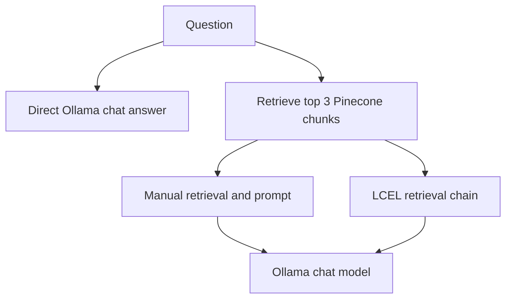

# Pinecone-Powered RAG System

A command-line LangChain project for indexing a text document in Pinecone and asking questions about it. It compares a direct Ollama response with two retrieval-augmented approaches: explicit Python steps and a LangChain Expression Language (LCEL) chain.

## Project overview

`mediumblog1.txt` is the source article about vector databases. `ingestion.py` loads and chunks the article, creates embeddings with Ollama, and adds them to Pinecone. `main.py` asks a fixed question in three ways:

1. A direct answer from the Ollama chat model, without retrieved context.
2. A retrieval answer assembled step by step in Python.
3. A retrieval answer composed with LCEL.

The scripts use `format_box` from `utils.py` to print boxed status and answer output.

## Workflow

### Ingest the document


`ingestion.py` reads `mediumblog1.txt` from the current working directory and splits it into 1,000-character chunks with no overlap. It embeds the chunks with `OLLAMA_EMBEDDING_MODEL` and sends them to Pinecone. If that variable is unset, ingestion defaults to `nomic-embed-text`.

### Ask a question



`main.py` uses `qwen3.5:9b` for chat and `qwen3-embedding:8b` for query embeddings. The retrieval prompt asks the model to answer based only on retrieved context.

## Requirements

- Python **3.13 or newer** and [uv](https://docs.astral.sh/uv/).
- [Ollama](https://ollama.com/) installed and running locally, with the chat and embedding models downloaded.
- A Pinecone account and API key.
- A Pinecone index whose vector dimension matches the embedding output. The default `qwen3-embedding:8b` output is 4096 dimensions; verify the index configuration before ingesting.
- Network access to Pinecone. Ollama runs locally unless `OLLAMA_HOST` points to another compatible service.

## Setup

### 1. Install the project dependencies

From the project root:

```bash
uv sync
```

`wcwidth`, used by the terminal box formatter, is included in the project dependencies.

### 2. Start Ollama and download the models

If Ollama is not already running, start it in a separate terminal:

```bash
ollama serve
```

Download the models used by `main.py`:

```bash
ollama pull qwen3.5:9b
ollama pull qwen3-embedding:8b
```

### 3. Configure Pinecone and the embedding model

Create a `.env` file in the project root:

```dotenv
PINECONE_API_KEY=your_pinecone_api_key
PINECONE_INDEX_NAME=your_existing_index_name
OLLAMA_EMBEDDING_MODEL=qwen3-embedding:8b
```

The `OLLAMA_EMBEDDING_MODEL` setting is important: `main.py` currently queries with `qwen3-embedding:8b`, while `ingestion.py` defaults to `nomic-embed-text` when the setting is absent. Set it as above so both scripts use the same model. If you choose another embedding model, update the model in `main.py` too and make sure the Pinecone index dimension matches its output.

The scripts also accept `INDEX_NAME` as a fallback if your `.env` already uses that variable. `.env` is ignored by Git; keep the real API key out of commits.

## Run the project

Run ingestion first to populate the Pinecone index:

```bash
uv run python ingestion.py
```

Then run the three answer approaches:

```bash
uv run python main.py
```

Run both commands from the project root. Edit `query` inside `main()` to ask a different question.

## Project structure

```text
.
├── README.md          # Project overview, setup, workflow, and notes
├── .gitignore         # Excludes local environments, credentials, and generated files
├── .python-version    # Selects Python 3.13
├── ingestion.py       # Loads, chunks, embeds, and indexes the source article
├── main.py            # Direct answer, manual retrieval, and LCEL retrieval examples
├── mediumblog1.txt    # Sample article about vector databases
├── pyproject.toml     # Project metadata and dependency declarations
├── utils.py           # Box formatting and time-formatting helpers
└── uv.lock            # Resolved dependency versions
```

## Notes

- **Pinecone index setup:** These scripts use an existing index; they do not create one. The index dimension must match the embedding vectors.
- **Re-ingestion:** `ingestion.py` does not clear existing vectors or assign stable IDs. Re-running it may add duplicate records.
- **Embedding endpoint error:** If the server reports `This server does not support embeddings`, check that `OLLAMA_HOST` points to a service that supports Ollama's `/api/embed` endpoint. If using `llama-server`, start it with embeddings enabled.
- **Source quality:** The copied article includes page navigation and image-caption text, which may appear in retrieved chunks.
- **Dependencies:** The project also declares LangChain integrations for Google GenAI, OpenAI, and Tavily, although these scripts do not use them directly.
